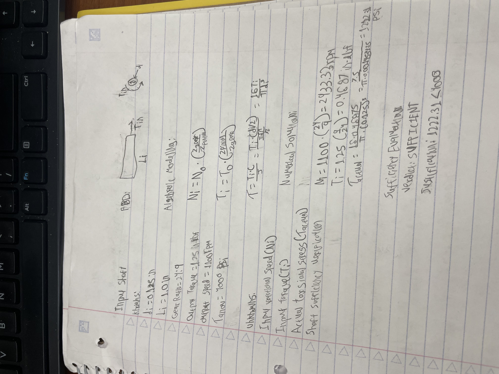
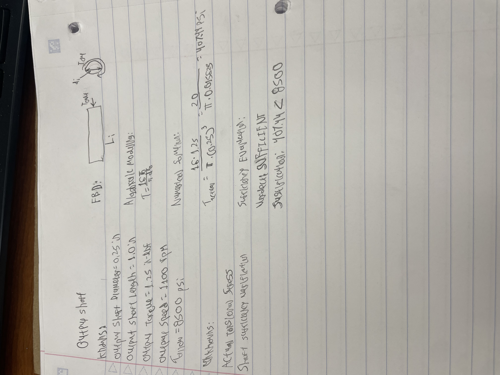
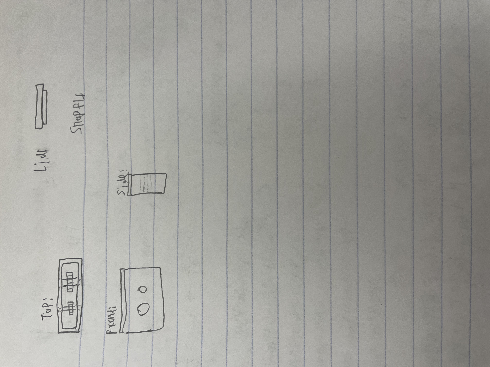
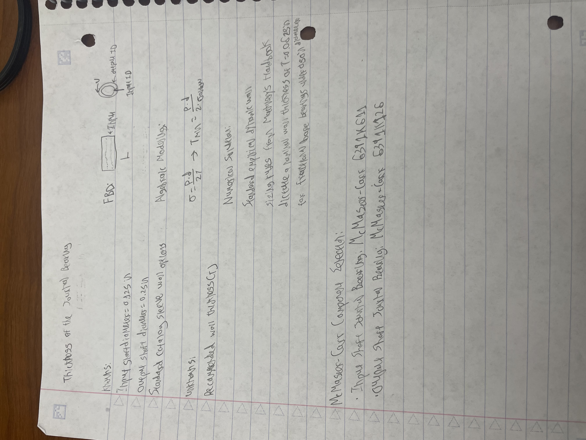
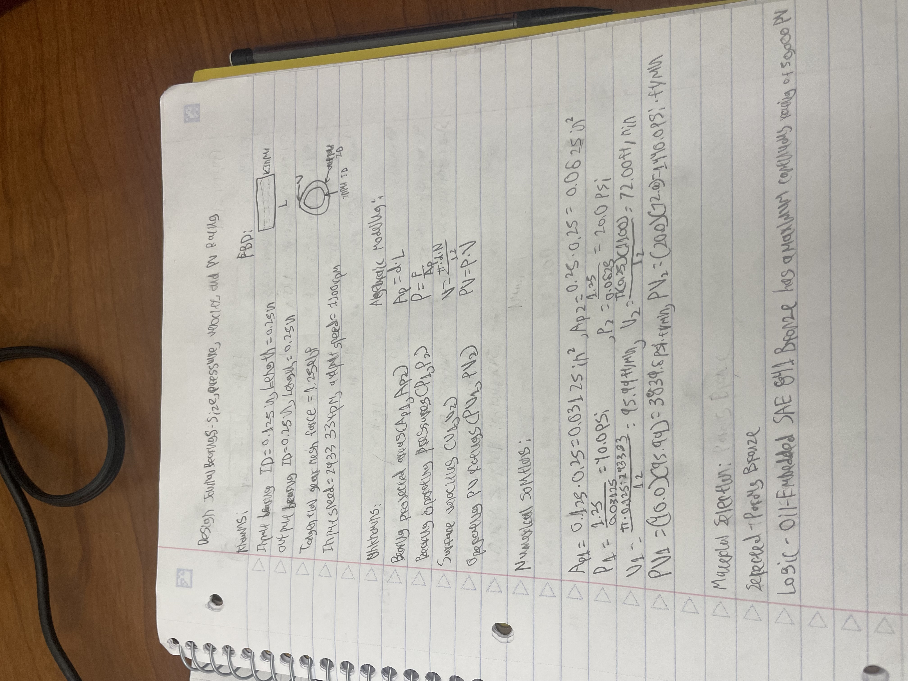

# Assignment 8: Gearbox Design & Analysis

## Overview
The goal of this assignment is to perform comprehensive mechanical design, stress analysis, bearing sizing, and parametric CAD modeling for a 24:9 spur gear reduction system. The custom assembly features a 2.0" × 2.0" × 1.0" two-part housing, precise 0.6875" center-to-center shaft spacing to ensure proper gear mesh, press-fit input/output shafts, and McMaster-Carr sleeve journal bearings.

---

## 1. Design of the Shafts

### 1.a. Input Shaft (Power-Transmission)
The input shaft transfers torque from the primary power source to the pinion gear (*d*in = 0.125 in, *L*in = 1.0 in).

* **Knowns:**
  * Output Torque (*T*out) = 1.25 in-lbf
  * Gear Ratio (*i*) = 24 : 9 = 2.667
  * Input Shaft Diameter (*d*in) = 0.125 in
  * Input Shaft Length (*L*) = 1.0 in
* **Unknowns:** Input Torque (*T*in), Maximum Shear Stress (&tau;in), Safety Factor.
* **Free Body Diagram (FBD):**

*Figure 1: Free Body Diagram and Handwritten Engineering Calculations for Input Shaft Stress*

* **Calculations:** 
  * *T*in = *T*out / *i* = 1.25 / 2.667 = 0.46875 in-lbf
  * &tau;in = 16 *T*in / (&pi; &middot; *d*in3) = 16(0.46875) / (&pi; &middot; 0.1253) &approx; 1,222.3 psi

*Figure 2: Parametric Solid Model of the Input Shaft (0.125 in Diameter)*

* **Verdict:** *Sufficient.* The calculated shear stress of 1,222.3 psi is well below the yield shear strength of standard steel shafting (&approx; 15,000 psi - 30,000 psi), providing a high safety factor against torsional yield.

---

### 1.b. Output Shaft (Short Shaft)
The output shaft supports the driven output gear (*d*out = 0.250 in, *L*out = 1.0 in).

* **Knowns:**
  * Output Torque (*T*out) = 1.25 in-lbf
  * Output Shaft Diameter (*d*out) = 0.250 in
  * Output Shaft Length (*L*) = 1.0 in
* **Unknowns:** Maximum Shear Stress (&tau;out), Safety Factor.
* **Free Body Diagram (FBD):**

*Figure 3: Free Body Diagram and Handwritten Engineering Calculations for Output Shaft Stress*

* **Calculations:** 
  * &tau;out = 16 *T*out / (&pi; &middot; *d*out3) = 16(1.25) / (&pi; &middot; 0.253) &approx; 407.4 psi

*Figure 4: Parametric Solid Model of the Output Shaft (0.250 in Diameter)*

* **Verdict:** *Sufficient.* The maximum shear stress of 407.4 psi is well within allowable material limits.

---

## 2. Design of Journal Bearings

### 2.a. Bearing Size, Pressure, Velocity, and PV Rating
Journal bearings were sized to support the shafts while maintaining smooth rotational operation and minimal wear under operating loads.

* **Knowns:** Speed *N* = 1100 rpm, Shaft Diameters (0.125 in and 0.250 in), Radial Forces derived from gear pitch loads.
* **Calculations:**
  * **Bearing Pressure (*P*):** *P* = *F*radial / (*d* &middot; *L*bearing)
  * **Surface Velocity (*V*):** *V* = (&pi; &middot; *d* &middot; *N*) / 12 (ft/min)
  * **PV Rating:** *PV* = *P* &times; *V*

*Figure 5: Calculations for Journal Bearing Pressure, Velocity, and PV Ratings*

---

### 2.b. Journal Bearing Wall Thickness
Wall thickness was verified using the press-fit and hoop stress equations to guarantee structural integrity of the housing wall during press-fit installation of the sleeve bearings.

---

### 2.c. McMaster-Carr Component Selection
Bronze SAE 841 oil-impregnated sleeve journal bearings were chosen from McMaster-Carr based on low friction coefficients, high allowable continuous PV ratings (*PV*allowable > 10,000 psi&middot;ft/min), and press-fit tolerances.

*Figure 7: McMaster-Carr Sleeve Journal Bearing Selection*

---

## 3. Gearbox Housing Concept & Layout
The gearbox housing consists of a two-part split design engineered for ease of manufacturing and assembly. The main housing body holds both sleeve bearings and provides an internal pocket clearing the 0.54" outer diameter 24-tooth gear. A top lid featuring a 0.8" × 0.8" locating plug secures the assembly cleanly without interfering with the internal power transmission components.

*Figure 8: Housing Concept & Layout Sketch*

---

## 4. Parametric CAD Assembly & Solid Models
Parametric 3D solid models were created in Creo Parametric to ensure proper spatial clearance and gear alignment. The assembly was built sequentially starting with the base housing, inserting press-fit bearings, mounting the input/output shafts and spur gears, and fastening the top housing cover.

*Figure 9: CAD Solid Model of the Housing Base and Top Lid*

*Figure 10: Complete Closed Gearbox CAD Assembly*

*Figure 11: Internal View Showing Meshed Gears, Shafts, and Journal Bearings*

---

## 5. Lessons Learned & Time Tracking
* **Total Project Time:** 6.5 hours (Calculations: 1.5 hrs, CAD Modeling & Assembly: 3.5 hrs, Portfolio Documentation: 1.5 hrs).
* **Lessons Learned:**
  * Accounting for full outer diameters of gears when designing housing clearance prevents interference during assembly.
  * Proper shaft extension lengths must be maintained beyond external housing faces for coupling access.
  * Split-housing designs must account for bearing alignment and draft angles during parametric modeling.

---

## Downloadable Deliverables

### CAD Files
- [Download Assembly CAD Package (ZIP)](https://github.com/njablons/MEGR-2156-Portfolio/raw/main/docs/assignments/A08/gearbox_assembly.asm.1) – Complete package containing all CAD files (`.prt`, `.asm`, `.drw`), STEP exports (`.stp`), and 2D engineering drawings (`.pdf`).
