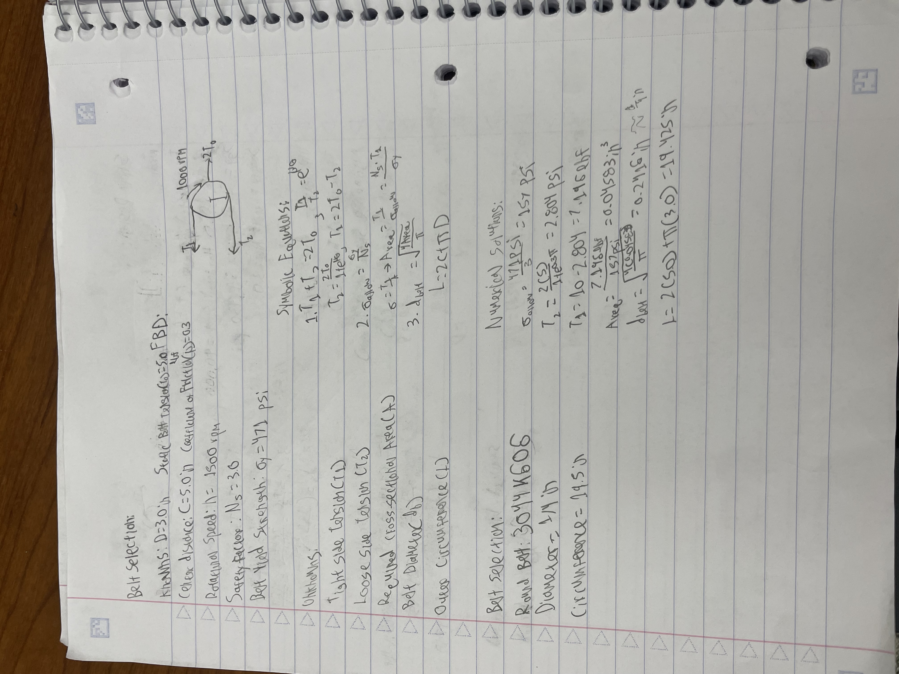
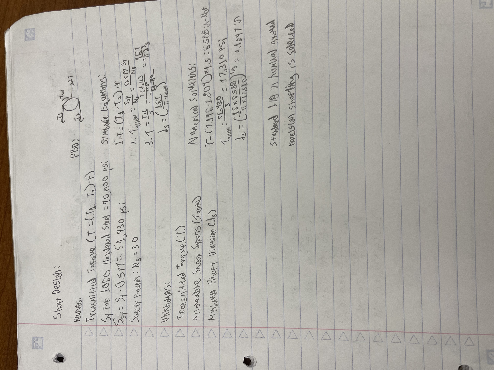
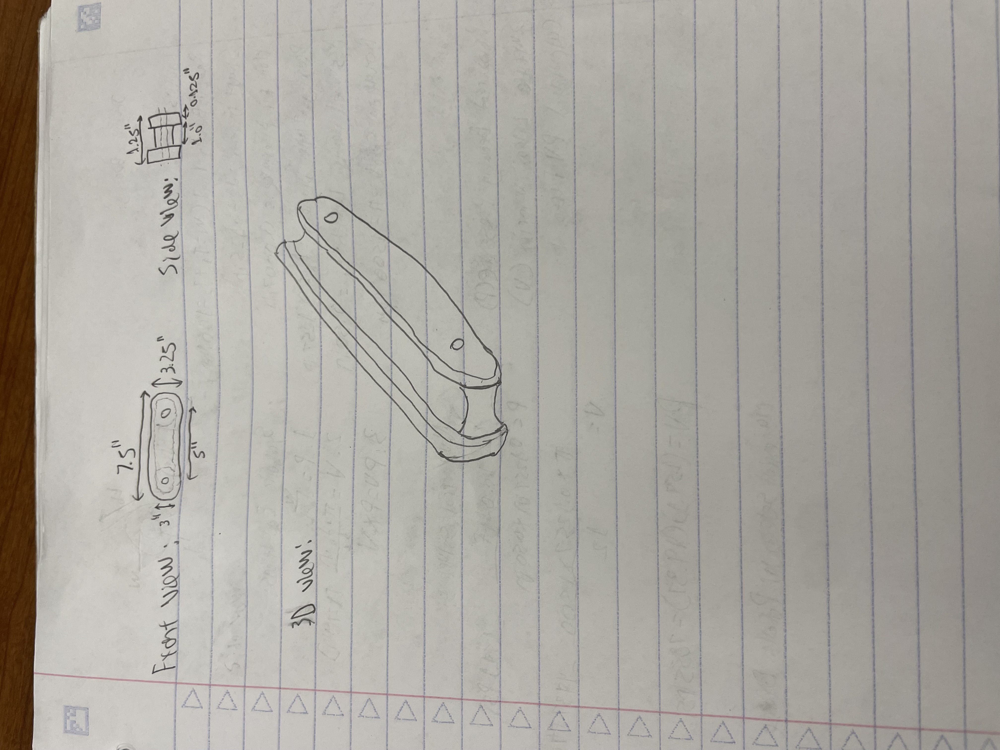

# A9 – Pulley System

## Objective

Designed a two-pulley power transmission system transferring rotational power between two parallel shafts separated by a center distance of 5.0 inches. The assignment requires calculating dynamic belt forces, sizing the drive shaft for torsional shear load, selecting a sintered journal bearing via *Machinery's Handbook* PV limits, engineering a supporting frame with side guide walls, and detailing lessons learned.

---

## Belt selection

### Symbolic Model & Derivations

* **Belt Tension Equilibrium:**

  T_1 + T_2 = 2 * T_0

  T_1 / T_2 = e^(μ * θ)

  Substituting T_1 = T_2 * e^(μ * θ) into the static equilibrium equation:

  T_2 * (1 + e^(μ * θ)) = 2 * T_0  ==>  T_2 = (2 * T_0) / (1 + e^(μ * θ))

  T_1 = 2 * T_0 - T_2

* **Allowable Normal Stress & Cross-Sectional Area:**

  σ_allow = σ_y / N_s

  A_req = T_1 / σ_allow = (N_s * T_1) / σ_y

* **Minimum Belt Diameter & Outer Circumference:**

  d_belt = sqrt((4 * A_req) / π)

  L = 2 * C + π * D

### Numerical Calculations

* **Tension Ratio & Forces:**
  * Tension ratio: T_1 / T_2 = e^(0.30 * π) = e^0.9425 ≈ 2.566
  * Loose side tension: T_2 = 2(5.0 lbf) / (1 + 2.566) = 10.0 / 3.566 = 2.804 lbf
  * Tight side tension: T_1 = 10.0 lbf - 2.804 lbf = 7.196 lbf

* **Allowable Stress & Required Cross-Sectional Area:**
  * Allowable stress: σ_allow = 471 psi / 3 = 157.0 psi
  * Required area: A_req = 7.196 lbf / 157.0 psi = 0.04583 in²

* **Minimum Belt Diameter & Pitch Length:**
  * Minimum belt diameter: d_belt = sqrt((4 * 0.04583 in²) / π) = 0.2416 in (approximately 1/4 in)
  * Pitch length: L = 2(5.0 in) + π(3.0 in) = 10.0 + 9.425 = 19.425 in

### Commercial Component Selection

* **Vendor & Part Number:** [McMaster-Carr Part #3044K606](https://www.mcmaster.com/products/round-belts/diameter~1-4-1/outer-circumference~19-1-2/)
* **Specifications:** Polyurethane Rubber Round Belt, 1/4" Diameter, 19-1/2" Outer Circumference
* **Engineering Justification:** The calculated theoretical pitch length is L = 19.425 in with a minimum required cross-sectional diameter of d_belt = 0.2416 in. [McMaster-Carr Part #3044K606](https://www.mcmaster.com/products/round-belts/diameter~1-4-1/outer-circumference~19-1-2/) (1/4 in nominal diameter, polyurethane rubber, 19-1/2 in outer circumference) satisfies both stress limits and length geometry while matching the polyurethane material specified in the prompt.

---

## Shaft Design

### Symbolic Model & Derivations

* **Applied Torque:**

  T = (T_1 - T_2) * r

* **Allowable Shear Stress (Distortion Energy Theory):**

  τ_allow = S_sy / N_s = (0.577 * S_y) / N_s

* **Minimum Shaft Diameter Derivation:**

  τ = (T * c) / J = (T * (d_s / 2)) / ((π * d_s^4) / 32) = (16 * T) / (π * d_s^3) <= τ_allow

  d_s = ((16 * T) / (π * τ_allow))^(1/3)

### Numerical Calculations

* **Net Transmitted Torque:**
  * T = (7.196 lbf - 2.804 lbf) * 1.5 in = 6.588 in-lbf

* **Allowable Shear Stress:**
  * τ_allow = (0.577 * 90,000 psi) / 3 = 51,930 psi / 3 = 17,310 psi

* **Minimum Shaft Diameter:**
  * d_s = ((16 * 6.588 in-lbf) / (π * 17,310 psi))^(1/3) = (0.001939)^(1/3) = 0.1247 in

* **Selected Shaft Size:** Standard 1/8 in nominal (0.125 in) precision ground 1060 hardened steel shafting.

---

## Journal Bearing

### Symbolic Model & Derivations

* **Projected Bearing Pressure (P):**

  P = W / (d_b * L_b)   where W = T_1 + T_2

* **Surface Linear Velocity (V):**

  V = (π * d_b * n) / 12   [ft/min]

* **Pressure-Velocity Product (PV):**

  PV = P * V

### Numerical Calculations

* **Bearing Inner Diameter:** d_b = 0.1250 in + 0.0007 in = 0.1257 in (RC5 Fit)
* **Projected Pressure (P):**
  * P = 10.0 lbf / (0.1257 in * 0.50 in) = 159.1 psi

* **Linear Velocity (V):**
  * V = (π * 0.1257 in * 1500 RPM) / 12 = 49.37 ft/min

* **PV Product Rating:**
  * PV = 159.1 psi * 49.37 ft/min = 7,855 psi-ft/min

### Material Selection

* **Selected Material:** **Porous Bronze (Sintered)**
* **Justification:** Based on Table 4 (pg. 2440) in *Machinery's Handbook*, oil-impregnated **Porous Bronze** provides a maximum allowable PV capacity of 50,000 psi-ft/min, a maximum static load rating of 2,000 psi, and a maximum continuous surface speed of 1,200 fpm. Our calculated operating parameters (P = 159.1 psi, V = 49.4 fpm, PV = 7,855 psi-ft/min) fall well within these allowable limits.

---

## Frame Design

### Engineering Drawing Specifications & Annotations

* **Front View Dimensions:**
  * **Center-to-Center Distance:** 5.00 in between shaft bores.
  * **Overall Frame Length:** 7.50 in (provides 1.25 in end margin past each 3.00 in pulley radius).
  * **Overall Frame Height:** 3.25 in (provides 0.125 in vertical clearance over the 3.00 in pulley diameter).
  * **Shaft Bores:** Ø 0.1257 in precision bored holes for housing porous bronze journal bushings.

* **Side View Dimensions:**
  * **Overall Frame Width:** 1.25 in
  * **Internal Channel Clearance Width:** 1.00 in (provides axial clearance for pulley width and belt line).
  * **Plate Wall Thickness:** 0.125 in (Aluminum 6061-T6 structural plates).

* **Retention Walls / Guide Rails:**
  * Raised 0.125 in flange walls run continuously along the perimeter to guide the round belt, preventing lateral tracking and axial dislodgement off the pulleys during dynamic 1500 RPM operation.

---

## Lessons Learned

* **Tensional Equilibrium in Belt Drives:** I learned how exponential friction engagement (e^(μ * θ)) across the contact arc dictates the maximum force differential between tight (T_1) and loose (T_2) sides before power-limiting slip occurs.
* **Distortion Energy Application in Shaft Design:** I learned how to apply Distortion Energy Theory (S_sy = 0.577 * S_y) to convert pure tensile yield strength into allowable shear stress when calculating minimum shaft diameters under pure torsional load.
* **PV Rating Evaluation for Journal Bearings:** I learned how to evaluate combined pressure (P) and velocity (V) parameters against standard industry tables in *Machinery's Handbook* (Table 4) to verify oil-impregnated porous metal sleeve longevity.
* **Constraint Integration in Chassis Design:** I learned how physical operational hazards require integrated structural features, such as perimeter retaining rails on chassis walls, to prevent lateral belt walk under dynamic vibration.
